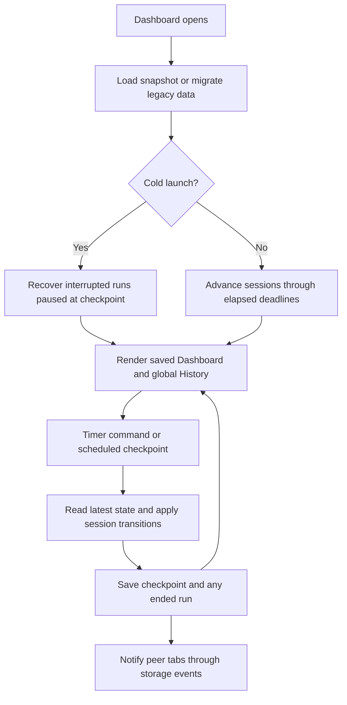

# Time And Date architecture

## Entry points and build boundaries

| Target | Entry and output | Runtime surface |
| --- | --- | --- |
| Web | `index.html` and `interval-timer-app/index.html` → `dist/` | Dashboard at `/` and `/dashboard`, History at `/dashboard/history`, shareable World Clocks at `/clocks`, standalone countdown tools at `/countdown`, and the Interval Timer PWA at `/interval-timer-app/`. The old `/duration` and `/interval-timer-v0` routes still resolve. |
| Time And Date native | `index.html` → `dist-native/` → tracked Capacitor shells | Dashboard and History, with Date Countdown, Countdown Timer, Interval Timer, and World Clock tiles. |
| Timers Dev native | `index.html` → `artifacts/timer-dev/web/` → generated Capacitor projects | The same Dashboard feature set under a separate app ID and local data container for development and QA. |

[Vite](../vite.config.js) selects the entry points and disables the web public directory for both native modes. [The router](../src/main.js) removes web-only routes from the native surface and loads the web-only linked-timer adapter on demand. The production web build generates a service worker scoped to the standalone Interval Timer path from the Vite manifest. Its cached files support offline reopening after installation of the cache. The main web site and PWA deploy as one bundle. [Service worker build](../scripts/build-interval-timer-sw.mjs) · [Mobile builds](mobile.md) · [Release guide](ci-cd.md)

## Dashboard ownership and navigation

The Dashboard owns its cards and presets. Standalone web timers use their own state. The web Dashboard can surface links to existing standalone timers on the original board, or the first remaining board if the original was removed. Shareable World Clocks links store curated city IDs in order. Dashboard links carry a local board ID and optionally an exact timer key. History is global and uses the selected board for return navigation. Off-board run links project unfinished Countdown and Interval sessions from storage and route back to the owning card. Those sessions continue on their own deadlines while their board is out of view. [Router](../src/main.js) · [Dashboard](../src/dashboard.js)

The first-run examples are ordinary saved cards. Initialization seeds them only when neither the current snapshot nor legacy dashboard data exists. The template resolver tries canonical locale, region, language, and global fallback. A regional layout can add one upcoming seasonal Date Countdown. Saving examples through the same repository as user-created cards makes editing and removal durable. [Templates](../src/dashboard-templates.js) · [Seasonal dates](../src/dashboard-holidays.js) · [Storage](../src/dashboard-data.js)

## Timing and local data

- [Timer sessions](../src/timer-session.js) owns Countdown and Interval lifecycle, phase deadlines, accepted actions, exact boundary observations and run statistics. Display ticks project elapsed time from deadlines. Start, pause, resume, skip, restart, reset and stop are applied according to the session type and phase. Interval activity can include preparation and rest between repetitions.
- [Time calculations](../src/time.js) use Temporal for Date Countdown wall time and named timezone conversion. Invalid times in a daylight saving gap or overlap are rejected. A Date Countdown retains its target instant across a pause. A paused duration or interval holds its remaining time. Standalone Interval Timer retains its own [routine engine](../src/timeandate/timer.js).
- [Dashboard data](../src/dashboard-data.js) stores schema-versioned boards, cards, presets, and up to 30 ended runs in a localStorage snapshot. It migrates older records and reads the latest snapshot before each mutation. Where supported, Web Locks serialize writes and detect a live peer document. Commands compare the expected session and track run identity so stale actions and repeated completion observations cannot record the same run twice. Storage events refresh peer tabs. A failed write can leave the Dashboard operating in memory with a storage notice.
- The repository checkpoints active sessions about every five seconds and flushes on hide. A cold launch restores interrupted running Countdown and Interval sessions paused at the saved checkpoint. A live view returning after suspension advances through elapsed deadlines. An ordinary pause remains distinguishable from recovery. Presets create fresh Ready sessions. History stores ended run statistics across boards.

## Foreground effects

Dashboard exposes running sessions to the cue policy on the selected board. Explicit per-timer Voice, Ticks, or Off controls new cue delivery. Dashboard mute overrides playback and preserves the saved choice. Legacy cue preferences still have a compatibility path. Wake is independent of the sound mode. Cues can expire or be invalidated when a phase or foreground context changes. Web uses browser APIs and Capacitor uses native adapters for speech and wake. The timer engine and History keep working if these capabilities are unavailable. [Cue design and extension guide](foreground-timer-cues.md)

## Maintenance

Use the [test plan](test-plan.md) for coverage and release evidence. The [searchable timezone picker and rule reconciliation](wip/timezone-picker-spec.md) and [cue language settings](wip/foreground-cue-languages.md) describe future work.
