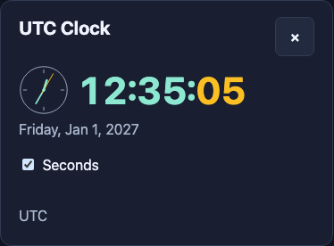
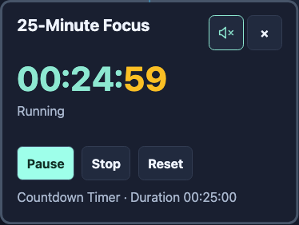

# Analog clocks and timer highlights

- World Clock tiles show an analog face beside the digital time. Turn on **Seconds** to show a second hand that ticks once per second.
- Dashboard and standalone timers highlight the smallest visible unit that changes in amber. When minutes and seconds change together, the seconds get the highlight.

## Screenshots

**World Clock with Seconds on.** The amber hand points to five seconds, matching the highlighted `05` in the digital readout.

**Countdown at a minute rollover.** The readout changes from `00:25:00` to `00:24:59`, and `59` turns amber.

