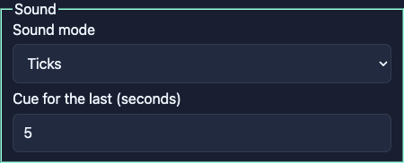

# Timer progress and sound controls

- Countdown tiles trace elapsed time clockwise around the border. The trace turns amber near the end and coral for the last five seconds. It freezes in slate when paused and closes into a green loop when complete.
- Countdown and Interval Timers have one sound mode for the whole timer. **Ticks** uses short tones for countdowns and interval transitions, with a chime at the end of each work period. **Voice** speaks countdowns, transitions, and completion. **Off** silences every cue from that timer. Set the final-seconds window in the editor.
- Click the sound icon to cycle through **Ticks**, **Voice**, and **Off** before starting, while running, or while paused. The speaker, speaking face, and crossed speaker show the selected mode. The choice saves to the timer.
- Cues play while the dashboard is in the foreground. Voice depends on speech support on the device or in the browser.

## Screenshots

**Countdown editor.** The highlighted Sound section shows the timer-wide mode and the final-seconds window.

**Running Countdown tile.** The amber trace shows elapsed time. The highlighted speaking-face icon shows that Voice is selected.

