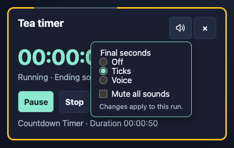

# Timer progress and sound controls

- Countdown tiles trace elapsed time clockwise around the border. The trace turns amber near the end and coral for the last five seconds. It freezes in slate when paused and closes into a green loop when complete.
- Countdown and Interval Timers offer **Off**, **Ticks**, and **Voice** for the final seconds. Choose how many seconds to cue. Countdown Timers also offer **Silent**, **Chime**, or **Voice** at zero.
- Open the speaker menu on a running or paused tile to change the final-seconds cue or mute all sounds. These choices apply to the current run in the current tab. Reloading clears them. The editor holds the saved settings.
- Cues play while the dashboard is in the foreground. Voice depends on speech support on the device or in the browser.

## Screenshots

**Countdown editor.** The highlighted Sound section shows which cues play in the final seconds and at zero.

**Running Countdown tile.** The amber trace shows elapsed time. The highlighted speaker menu shows the current run’s cue and mute controls.

