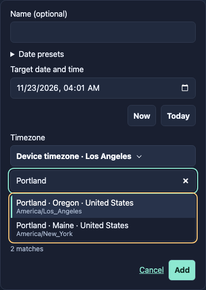
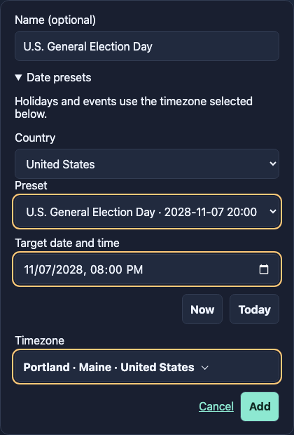

# Search timezones and choose date presets

- Search by city, alternate name, or timezone ID when setting up a Dashboard Date Countdown or World Clock. The standalone web Date Countdown uses the same picker. New forms start in the device timezone. The picker bundles a curated city list for offline search and also lists every timezone supported by the device.
- Dashboard Date Countdown offers a curated set of holiday presets for the United States, Canada, and India, plus handpicked timed events. Choosing a preset fills in the name and local date and time in the selected timezone. Changing the timezone keeps the displayed date and time and changes the instant the countdown targets.
- The standalone World Clocks board keeps its existing **Add a city** control. Date presets are available in Dashboard on web and mobile.

## Annotated screenshots

**City search.** The highlighted results show Portland, Oregon and Portland, Maine as separate options with their timezone IDs.

**Timed preset.** The highlighted fields show the U.S. General Election Day preset, its 8 p.m. local countdown target, and the selected Portland, Maine timezone.

