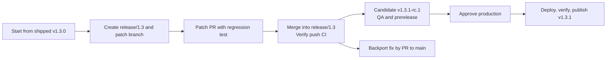

# CI/CD and releases

## New feature

```mermaid
flowchart LR
  A["Push feature branch"] --> B["PR to main"]
  B --> C["Required CI<br />Workflow lint, tests, build"]
  C --> D["Merge and verify push CI<br />Web and Capacitor build targets"]
  D --> E["Candidate v1.3.0-rc.1<br />Build once and checksum"]
  E --> F["Deploy to QA and smoke-test"]
  F --> G["Publish prerelease"]
  G --> H["Promote<br />GitHub production approval"]
  H --> I["Deploy identical bundle and smoke-test"]
  I --> J["Publish v1.3.0"]
```

## Bug fix

## Bring a fix from main into an open RC

Suppose QA is testing `v0.2.0-rc.1`. New work has already landed on `main`, and a fix for an RC1 bug has also landed there. To include only the fix in `v0.2.0-rc.2`:

1. If the release line does not exist yet, create and push `release/0.2` from the `v0.2.0-rc.1` tag.
2. Create a fix branch from `release/0.2` and cherry-pick the bug-fix commit from `main`. If it depends on newer code, adapt the fix and its regression test to the release branch. Open a PR into `release/0.2`.
3. After merging, wait for **push CI** on `release/0.2` to pass. Copy the full SHA of that tested commit.
4. Run **Actions → Release** from workflow ref `main`. Set `operation` to `candidate`, `tag` to `v0.2.0-rc.2`, and `source_sha` to the tested release-branch SHA. A blank `source_sha` would select `main` and include its newer work.
5. Verify the fix in QA and promote `v0.2.0-rc.2` after approval. The published RC1 remains available as its own tag and bundle.

## Run a release

1. Merge a feature into `main` or a patch into the corresponding `release/<major>.<minor>` maintenance branch. Wait for the CI **push** run for that commit to succeed.
2. From **Actions → Release → Run workflow**, select workflow ref `main` and operation `candidate`. Leave `source_sha` blank to build the commit at `main` when you start the run. For a maintenance release or an RC that must exclude newer work on `main`, use the full SHA from the tested `release/<major>.<minor>` branch and enter an explicit tag.
3. With `tag` blank, the workflow continues the highest unshipped RC line in the selected commit's history that is at least the declared package version and newer than the latest stable tag. Otherwise it uses the package version if ahead of stable, or starts the next minor line after stable. Select **major_release** with a blank tag to start or continue the next major line after the latest stable release. For example, with stable `v0.6.0` and an existing `v1.0.0-rc.1`, the major option selects `v1.0.0-rc.2`. Open the workflow run's **Summary** to see the requested inputs, resolved tag, and exact source commit.
4. The run checks the commit and CI, builds the web bundle, stamps its source SHA and candidate tag, and computes a SHA-256 checksum. QA deploys the bundle and checks its live identity and key routes. When the bundle includes Multi Timer, smoke checks also cover the integrated route, standalone page, manifest, and service worker. A successful QA run publishes the bundle and checksum as prerelease assets. Test the user-facing behavior on QA before promoting.
5. Dispatch `promote`. Leave `tag` blank to select the highest published RC by version and RC number, skipping versions that already have a stable tag. Enter an explicit RC tag to promote a specific candidate. Review the selected tag and digest in the plan summary and confirm they match the candidate you tested before selecting **Review deployments → Approve and deploy**. The production job deploys the verified candidate bundle, validates live identity, and publishes the stable tag and release with identical assets. The deployed manifest retains the original candidate tag to identify the payload. The stable release notes link it to the release version.
6. If production needs recovery, dispatch `rollback` with an earlier stable tag. Review and approve it through the same production environment. Rollback uses the saved bundle and verifies the live result.

## Release from an older production tag

Create a release branch only when you need it. The workflow builds and deploys a tested commit. Creating the branch from a tag, applying the change, and merging its PR are separate Git steps.

| If `v1.0.0` is already live | Base tag | Branch to create | Explicit candidate tag | Release type |
| --- | --- | --- | --- | --- |
| Fix a bug on the old `0.6` line | `v0.6.0` | `release/0.6` | `v0.6.1-rc.1` | Patch |
| Add a compatible feature to the old `0.x` line | `v0.6.0` | `release/0.7` | `v0.7.0-rc.1` | Minor |
| Restore the exact build that previously shipped | Published `v0.6.0` | None needed | Use `rollback` with stable tag `v0.6.0` | Restore |

For example, to prepare the minor release:

1. Run `git fetch origin --tags`, then `git switch -c release/0.7 v0.6.0` and `git push -u origin release/0.7`. If the branch already exists, check it out and verify its history before adding the change.
2. Open and merge a feature PR into `release/0.7`. A branch from `v0.6.0` predates the candidate browser gate. Add or backport the `test:e2e` script, Playwright dependency, and browser scenarios appropriate to the older UI. Make sure they pass against that branch's production build. Wait for the release branch's push CI to pass.
3. In **Actions → Release → Run workflow**, select `main`, set `operation=candidate`, enter `v0.7.0-rc.1` in `tag`, and enter the tested release-branch SHA in `source_sha`. Leave **Major release** off. Verify the source and tag in the run summary and test the build on QA.
4. If you intend to put `0.7.0` live, run `promote` with that exact candidate tag and approve deployment. The current workflow has one production web target, so this replaces the live `1.0.0` build. To keep `1.0.0` live, stop after QA publishes the prerelease. Publishing a stable maintenance release in parallel requires a separate publish path or deployment target.

## Troubleshooting

- **CI or QA failed.** Fix the cause and run again with the same candidate tag if it is still unused. Move to the next RC number after publication.
- **Production deploy or verification failed.** Inspect the job and current `/build-info.json` on production. If the stable tag has not been created, rerun promotion or restore the prior stable version.
- **Release waiting for approval.** Open the **Release** run and review its plan output. The production secrets become available to the deployment job after review.
- **Concurrent releases.** Release runs share one concurrency group. Avoid dispatching multiple pending releases, since a newer pending run can replace an older one.
- **Mobile artifacts.** **Build mobile apps** produces debug QA artifacts. **Build signed mobile apps** produces signed Android and iOS packages for store QA and production. See the [mobile build guide](mobile.md) for signing setup and manual store distribution.

A SHA-256 checksum detects changed or corrupted bytes. Control over publishing releases and writing release tags establishes who can supply those bytes.
