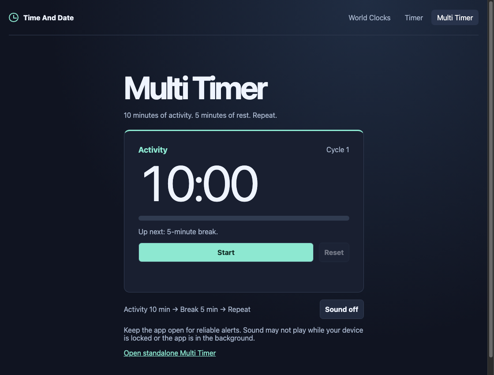
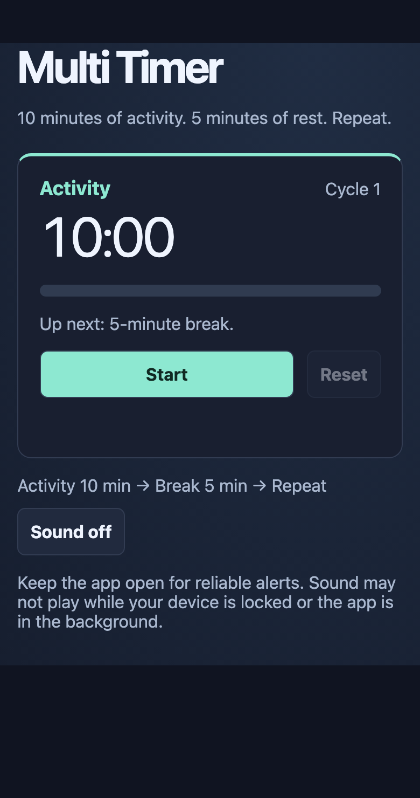

# Time And Date CI/CD · From commit to production

I needed to add a new timer to the existing Time And Date website. On mobile, I wanted to give Multi Timer its own installable app and keep the existing Android and iOS apps focused on the tools their users already knew.

I kept the tools in one repository and one web application so they could reuse styling, common code, and build scripts. The website and the installable app both use the same Multi Timer implementation, so a fix can be made once and tested in both places. A separate entry point gives the timer its own mobile experience without adding another codebase to maintain.

## Build targets

| Target | Local command | Output |
| --- | --- | --- |
| Website and standalone PWA | `npm run build` | `dist`, with the integrated website and the installable `/interval-timer-app/` entry |
| Existing Android and iOS app | `npm run mobile:build` | `dist-native`, with the existing native tools |
| Capacitor projects | `npm run mobile:sync` | Copies the native target into Android and iOS |

The website and standalone PWA share the Multi Timer view. The standalone entry mounts only that view and has its own manifest, icons, and service worker scope. The post-build script walks Vite’s manifest to generate the offline cache list from the entry’s actual JavaScript and CSS dependencies. The native target omits the feature at build time. Both local developer machines and GitHub’s Android and iOS jobs use the same sync command.

*Integrated route viewed in the local production preview.*

*Standalone PWA viewed in Chrome’s mobile emulation.*

## Release path

1. **Validate the change.** Push `feat/multi-timer` to GitHub and open a pull request into `main`. CI lints the workflows, installs from the lockfile, runs tests, and builds both targets. The release workflow verifies that the selected commit passed push CI after merge.
2. **Build and deploy a candidate.** The manually dispatched **candidate** operation pins a source SHA, builds the web bundle, records the candidate tag and SHA in build metadata, and generates a SHA-256 checksum. The QA job verifies and deploys that artifact to Cloudflare.
3. **Verify QA.** Smoke checks verify the live build identity and key URLs, including the standalone manifest and service worker for this bundle. A successful job publishes the archive and checksum as a GitHub prerelease. The resulting QA site is available for manual browser and install checks.
4. **Promote the verified artifact.** The **promote** operation downloads the selected candidate and verifies its checksum. After GitHub production approval, the workflow deploys the same archive to production, runs smoke checks, and publishes a stable release. **Rollback** can redeploy a prior stable archive through the same approval path.

The standalone mobile app is distributed through the web release. The separate, manually dispatched native workflow produces an Android debug APK and a zipped iOS Simulator build of the existing app. The release path above describes how the example moves through the pipeline. The screenshots show local preview output.

## FAQ

### What makes the standalone version an app?

It’s a progressive web app (PWA). Its manifest gives it a name, icon, and launch URL, so supported browsers can install it and open it from the home screen. Its entry page loads only the Multi Timer interface.

### How do you keep the new timer out of the existing mobile apps?

The native Vite target excludes the feature’s route, code, and standalone assets. Capacitor copies only that target’s output from `dist-native` into the Android and iOS projects.

### Can the website and the PWA ship independently?

They share one artifact and one release schedule today. That keeps shared code in sync. Independent release schedules would require separate build artifacts and deployment targets, even if both builds stayed in the same repository.

### What needs to be tested when shared code changes?

CI tests the source and builds both targets. Smoke checks verify the deployed build and key routes. QA can then check the integrated timer and the standalone install, including an offline launch after the first online visit. Changes to shared styling also warrant checking the other tools that use it.

### What happens if a release breaks one entry point?

Rollback restores the previous stable web bundle. If that bundle includes the standalone app, installed copies can continue serving newer cached files until the restored service worker version activates. A rollback to a release that predates the PWA removes its files from the server, and a phone may still have a cached copy.
