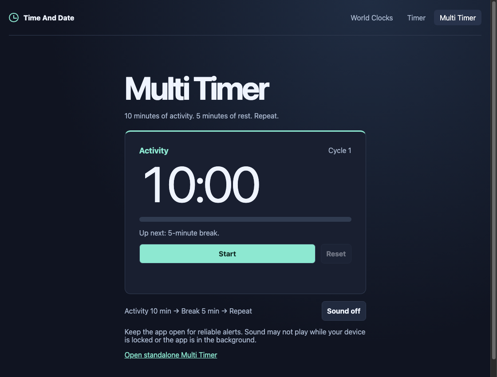
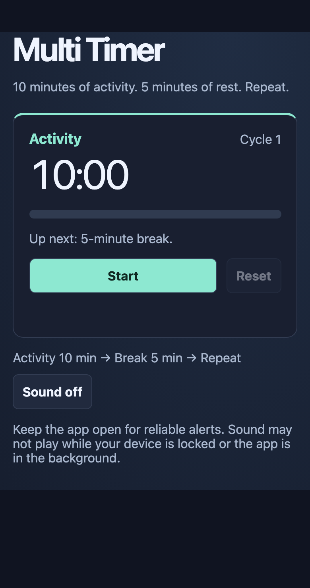

# How I ship a feature from a pull request to production

*One source tree, a website and an installable mobile app, and the same release bundle in QA and production.*

I needed to add a new timer to the Time And Date website. On mobile, I decided to give Multi Timer its own installable app. That lets people open it directly from their home screen and keeps the existing Android and iOS apps focused on their original tools.

I wanted one place to maintain the styling and code shared across the Time And Date tools. Keeping the website and the standalone timer in the same repository lets both use the same timer view and build scripts. A change to the view can go through one pull request and be checked in both places. The standalone app only needs its own entry page and the files that make it installable.

## The build decides what goes where

Locally, I use `npm run dev` to work on both browser entry points. When I want to see what will ship, I run `npm run build` and `npm run preview`. Vite builds the integrated website and the standalone page into `dist`. They share the Multi Timer view. The standalone entry starts directly in that view, so its interface contains only Multi Timer. Its web app manifest gives it an installable identity, and a scoped service worker supports reopening it offline after the first successful online load.

The service worker’s cache list is generated after Vite finishes. The script walks the standalone entry’s dependency graph in the Vite manifest and caches the generated files by name. I can change the source and rebuild without updating a hand-maintained list of hashed JavaScript and CSS filenames.

*The integrated route in a local production preview.*

*The standalone mobile entry in Chrome’s mobile emulation.*

For the existing Android and iOS apps, `npm run mobile:sync` builds a different Vite target and copies `dist-native` into the two Capacitor projects. That target omits the Multi Timer navigation, implementation and standalone assets. I can also run `npm run mobile:build` when I only want to inspect the files that will enter the native packages. The native GitHub workflow calls the same sync script for each platform.

## A green commit becomes a QA candidate

I start from the feature branch, `feat/multi-timer`. The path to release is to push it to GitHub, open a pull request into `main`, and merge after the checks pass. CI lints the GitHub Actions workflows, installs dependencies from the lockfile, runs tests, and builds both targets. After the merge, the Release workflow looks for a successful **push** CI run for the exact commit selected as the release source.

I then dispatch **Release** with the **candidate** operation. With the inputs empty, it uses the `main` commit at dispatch and derives the next release candidate tag from the version in that commit. It builds the web output, stamps it with the candidate tag and commit SHA, compresses it, and calculates a SHA-256 checksum.

The QA job verifies the checksum, deploys to Cloudflare, and checks that the live site identifies itself as the expected build. For this example it also checks the integrated route, the standalone page, the manifest, and the service worker. Once those checks pass, GitHub publishes a prerelease with the bundle and checksum attached. That gives me a specific candidate to review in QA. I can open the standalone entry on a phone, install it, and try reopening it offline.

## Production gets the bundle QA saw

When QA is ready, I dispatch **promote** with the prerelease tag. The workflow downloads the published bundle, verifies its checksum, and shows the digest for review. After approval through the GitHub production environment, it deploys those same bytes to Cloudflare production and runs the smoke checks again. Only after they pass does it publish the stable GitHub release.

The standalone mobile app ships with that web deployment. The separate **Build mobile apps** workflow creates a debug APK and an iOS Simulator build for testing the existing Capacitor app. The production release in this example is the Cloudflare deployment and its stable GitHub release.

The same artifact-based approach supports rollback. I can select a previous stable tag, approve the deployment, and restore its stored bundle. Its smoke checks follow the contents of the selected release, so a bundle built before Multi Timer can still be restored.

## FAQ

### What is a PWA, and how does someone get it?

A progressive web app (PWA) is a web app that can be installed on supported devices. For Multi Timer, the user opens `/interval-timer-app/` and uses the browser’s install or Add to Home Screen option. The icon opens the timer directly. After the service worker has cached the files on a successful online visit, the app can reopen offline.

### Does one repository mean every app gets every tool?

Each entry point determines what the user sees, and the build target determines what goes into the package. The standalone page mounts the Multi Timer view. The Capacitor target leaves Multi Timer’s code and assets out of the existing Android and iOS packages.

### Can I change the standalone app without changing the website?

I can change its icon, manifest, or entry page without editing the integrated route. A change to the shared timer view can affect both. They still ship in one web release, so I test both when I touch something they share.

### What would make separate deployments worth it?

If the website and standalone app needed different release schedules or separate rollbacks, I’d give them their own build artifacts and deployment targets. They could still share code in one repository. With the current setup, a fix to shared code goes through QA and promotion once for both entry points.

### How do I check that the split actually works?

Locally, I preview both web routes and inspect the assets copied into the Capacitor projects. In CI, both build targets must pass. The deployed smoke checks confirm the expected build and URLs, while a manual QA check can cover home-screen installation, offline reopening, and the existing tools that rely on shared styles.

### What happens to the installed app during a rollback?

Production serves the previous web bundle after rollback. If it includes the PWA, a phone can keep using its newer cached files until the restored service worker version activates. If the restored release predates the PWA, the standalone files disappear from the server and a previously installed copy may still have those files cached.
